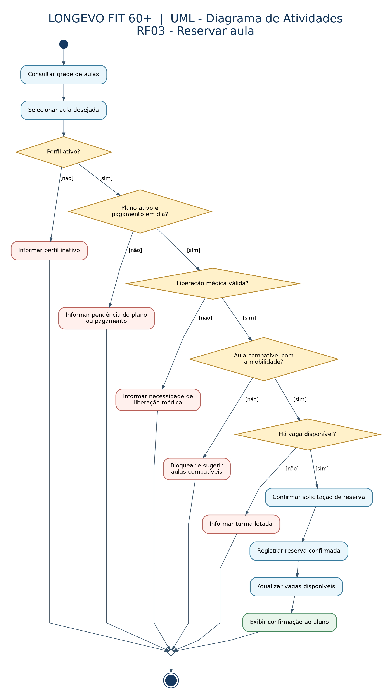
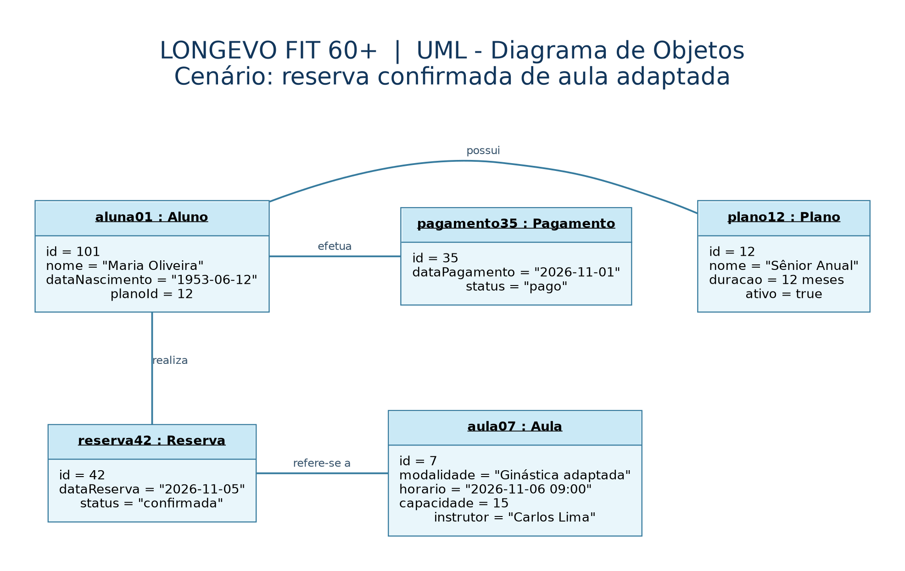
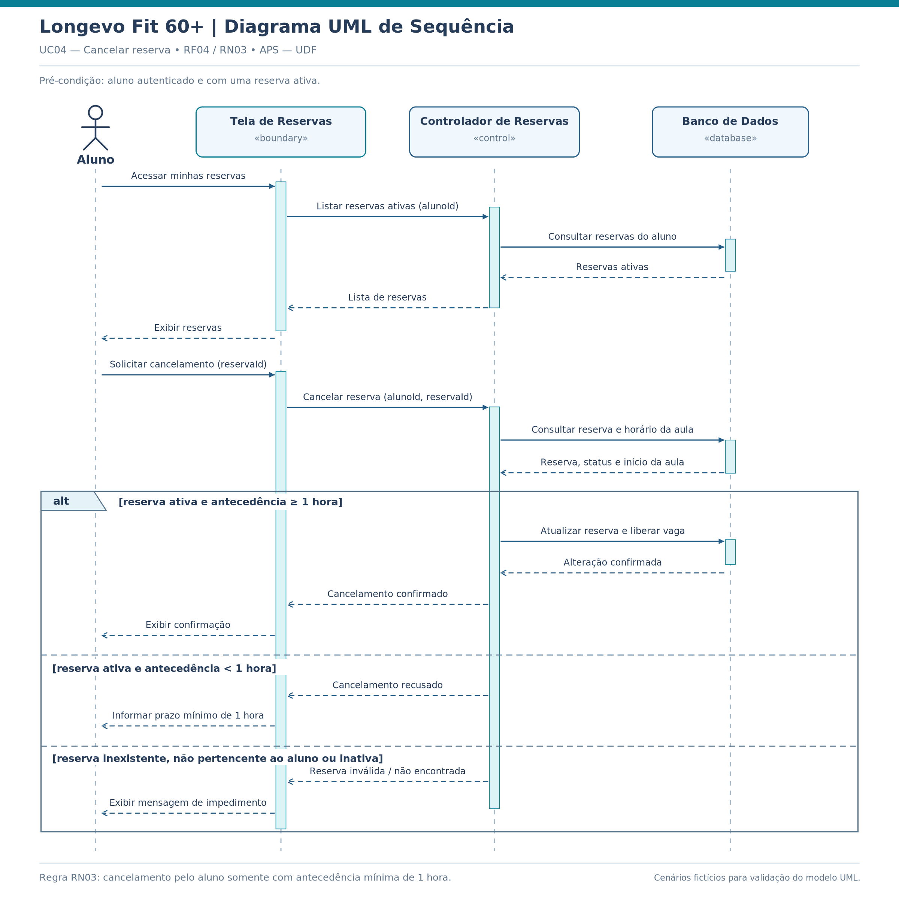

# Diagramas UML — Longevo Fit: Academia 60+

**Instituição:** UDF Centro Universitário  
**Curso:** Engenharia de Software  
**Disciplina:** Análise e Projeto de Sistemas (APS)  
**Professora:** Kadidja Valéria  
**Turma:** D2  
**Data:** 05/11/2026  
**Versão da documentação:** 1.3

**Integrantes:** Pedro Henrique Silva Monteiro; Pedro Borges Prudente Machado; Yago Alves de Carvalho; Robson Otávio Queiroz Castro; Igor Jesus da Silva Tolentino; Luiz Daniel da Costa Bastos.

## Objetivo

Documentar os comportamentos e os relacionamentos do sistema **Longevo Fit: Academia 60+**, usando requisitos levantados pelo grupo e a modelagem UML existente. Esta entrega contém **Diagrama de Atividades**, **Diagrama de Objetos** e **Diagrama de Sequência**, cada um em **PNG para visualização** e **.drawio editável**.

## Arquivos

| Diagrama | Exportação PNG | Fonte editável Draw.io |
|---|---|---|
| Atividades — reservar aula | [Visualizar PNG](atividades/diagrama-atividades-reserva.png) | [Editar `.drawio`](atividades/diagrama-atividades-reserva.drawio) |
| Objetos — reserva confirmada | [Visualizar PNG](objetos/diagrama-objetos-reserva.png) | [Editar `.drawio`](objetos/diagrama-objetos-reserva.drawio) |
| Sequência — cancelar reserva | [Visualizar PNG](sequencia/diagrama-sequencia-cancelar-reserva.png) | [Editar `.drawio`](sequencia/diagrama-sequencia-cancelar-reserva.drawio) |

## 1. Diagrama de Atividades — RF03: Reservar aula



**Processo:** o aluno autenticado consulta a grade de aulas, seleciona uma aula adaptada e solicita uma reserva. Antes de confirmá-la, o sistema verifica situação do perfil, plano e pagamento, liberação médica, compatibilidade de mobilidade e disponibilidade de vagas.

**Caminho de sucesso:** consultar grade → selecionar aula → validar perfil ativo → conferir plano e pagamento → verificar liberação médica → avaliar compatibilidade com a mobilidade → conferir vagas → confirmar solicitação → registrar reserva → atualizar vagas → exibir confirmação.

**Alternativas previstas:** perfil inativo, plano/pagamento irregular, liberação médica inválida, aula incompatível e turma lotada. Cada condição impede a confirmação e apresenta mensagem apropriada; a incompatibilidade de mobilidade também prevê sugestão de aulas adequadas (CA-03).

**Elementos UML:** nó inicial, ações, decisões com guardas `[sim]` / `[não]`, mesclagem dos caminhos e nó final. Não foi criado paralelismo artificial; `fork` e `join` não se aplicam ao fluxo descrito.

**Cenários de validação conceitual:**

| Cenário | Condição | Resultado esperado |
|---|---|---|
| CA-01 — sucesso | Aluno regular, liberação válida, aula compatível e vaga disponível | Reserva confirmada |
| CA-02 — aula lotada | Nenhuma vaga disponível | Reserva impedida e ausência de vagas informada |
| CA-03 — mobilidade incompatível | Aula acima da mobilidade permitida | Reserva bloqueada; sugestão de alternativas adequadas |
| Liberação inválida | Documento médico vencido ou ausente | Reserva impedida e solicitação de regularização |
| Pagamento irregular | Plano inativo ou pagamento pendente | Reserva impedida |

*Esses são percursos de verificação do modelo, não testes automatizados de um sistema implementado.*

## 2. Diagrama de Objetos — RF03: Reserva confirmada



**Cenário fictício:** em **05/11/2026**, Maria Oliveira, 73 anos, possui um plano Sênior Anual ativo, realizou pagamento em dia e tem uma reserva confirmada para **Ginástica adaptada**, em **06/11/2026 às 09h**.

| Instância : Classe | Valores representados |
|---|---|
| `aluna01 : Aluno` | `id = 101`; `nome = "Maria Oliveira"`; `dataNascimento = "1953-06-12"`; `planoId = 12` |
| `plano12 : Plano` | `id = 12`; `nome = "Sênior Anual"`; `duracao = 12 meses`; `ativo = true` |
| `pagamento35 : Pagamento` | `id = 35`; `dataPagamento = "2026-11-01"`; `status = "pago"` |
| `reserva42 : Reserva` | `id = 42`; `dataReserva = "2026-11-05"`; `status = "confirmada"` |
| `aula07 : Aula` | `id = 7`; `modalidade = "Ginástica adaptada"`; `horario = "2026-11-06 09:00"`; `capacidade = 15`; `instrutor = "Carlos Lima"` |

**Links:** `aluna01 — plano12`, `aluna01 — pagamento35`, `aluna01 — reserva42` e `reserva42 — aula07`. Os retângulos usam títulos de instâncias sublinhados e valores concretos, não a descrição genérica das classes. Os links devem permanecer coerentes com o Diagrama de Classes do grupo.

**Nota:** identificadores, pessoas, datas e valores são fictícios, usados exclusivamente para modelagem.

## 3. Diagrama de Sequência — RF04 / UC04: Cancelar reserva



**Processo:** aluno autenticado solicita o cancelamento de uma reserva já existente. Os participantes são **Aluno**, **Tela de Reservas**, **Controlador de Reservas** e **Banco de Dados**. As mensagens indicam solicitações e retornos na ordem cronológica.

**Caminho de sucesso:** consultar reservas ativas → solicitar cancelamento → consultar dados da reserva e horário de início da aula → validar titularidade, estado da reserva e antecedência mínima de **1 hora** → cancelar reserva e liberar vaga → confirmar o resultado ao aluno.

**Caminhos alternativos:**

- **RN03 — antecedência inferior a 1 hora:** operação recusada, com informação do prazo mínimo.
- **Reserva inválida:** reserva inexistente, inativa ou pertencente a outra pessoa; o sistema não efetua alteração e apresenta mensagem de impedimento.

| Cenário de validação conceitual | Resultado esperado |
|---|---|
| Reserva ativa; pedido com 90 minutos de antecedência | Cancelamento confirmado e vaga liberada |
| Reserva ativa; pedido com 30 minutos de antecedência | Cancelamento recusado pela RN03 |
| Reserva inexistente, inativa ou de outro aluno | Operação bloqueada sem alteração de dados |

A checagem de titularidade foi acrescentada como cuidado de segurança alinhado à **RNF01** do projeto; não deve ser interpretada como requisito já validado pelo stakeholder. O cenário cobre o cancelamento **pelo aluno**.

## 4. Rastreabilidade

| ID | Fonte | Representação |
|---|---|---|
| **RF03** — Reservar aula | Ficha de elicitação e documento geral do projeto | Atividades e Objetos |
| **RF04 / UC04** — Cancelar reserva | Documento do projeto, seções 5 e 6.1 | Sequência |
| **RN01 (ficha)** — Aula com vaga | Ficha Longevo Fit | Decisão de vagas em Atividades |
| **RN04 (ficha)** — Plano ativo e pagamento em dia | Ficha Longevo Fit | Decisão de regularidade em Atividades; Plano/Pagamento em Objetos |
| **RN05 (ficha)** — Liberação médica válida | Ficha Longevo Fit | Decisão de liberação em Atividades |
| **RN07 (ficha)** — Compatibilidade da mobilidade | Ficha Longevo Fit | Decisão e alternativa em Atividades |
| **CA-01, CA-02, CA-03** | Ficha Longevo Fit | Percursos de sucesso, ausência de vagas e incompatibilidade |
| **RN01 (documento geral)** — Perfil ativo | Documento geral do projeto, seção 5.3 | Decisão de perfil em Atividades |
| **RN02 (documento geral)** — Capacidade da turma | Documento geral do projeto, seção 5.3 | Decisão de vagas em Atividades |
| **RN03 (documento geral)** — Cancelar com ≥ 1 hora | Documento geral do projeto, seção 5.3 | Guarda no fragmento alternativo de Sequência |
| **RNF01** — Controle de acesso | Documento geral do projeto | Proteção de titularidade em Sequência |

### Pendências de harmonização do modelo

- **Numeração de regras:** as duas fontes usam IDs de regras de negócio diferentes. A origem foi explicitada acima, para evitar confundir RN01 (ficha) com RN01 (documento geral).
- **Modelo de classes:** o Diagrama de Classes existente contempla `Aluno`, `Plano`, `Pagamento`, `Reserva` e `Aula`, mas ainda não detalha os atributos ou classes necessários à **liberação médica** e à **mobilidade**. O Diagrama de Atividades contempla essas verificações conforme a ficha refinada. A equipe deve revisar o modelo de classes antes da implementação; não foram inventados objetos médicos para o Diagrama de Objetos.
- **Validação com stakeholder:** a ficha informa que RF03 está pendente de validação. O efeito do vencimento de uma liberação médica sobre reservas futuras continua em aberto; a sugestão da ficha não é tratada aqui como regra aprovada.
- **Associações:** conferir os links do Diagrama de Objetos com a versão definitiva do modelo de classes, caso a equipe altere a estrutura.

## 5. Ferramentas e edição

Os desenhos são disponibilizados em **diagrams.net (Draw.io)**, com formas, conectores e textos editáveis. Para alterar qualquer diagrama:

1. Abrir <https://app.diagrams.net/>.
2. Selecionar **Arquivo → Abrir de → Dispositivo** e carregar o arquivo `.drawio` correspondente.
3. Salvar o arquivo editável após as modificações.
4. Usar **Arquivo → Exportar como → PNG** e substituir a imagem exportada no mesmo caminho, verificando legibilidade.

Os arquivos PNG são cópias de visualização; alterações no `.drawio` não os atualizam automaticamente.

## 6. Versionamento e entrega

No repositório GitHub do **projeto do grupo**, manter exatamente esta organização sob `docs/uml/`. Após revisão dos arquivos, publicar com um commit descritivo, por exemplo:

```bash
git add docs/uml/
git commit -m "docs(uml): adiciona diagramas de atividades objetos e sequencia do longevo-fit"
git push
```

Para identificar o commit entregue:

```bash
git rev-parse HEAD
```

**Informar na entrega:** link real do repositório GitHub do projeto e hash do commit final. Nenhum link ou commit foi inventado nesta documentação; o envio depende da publicação efetiva.

## 7. Documentos de referência

- *Ficha de Elicitação de Requisitos — Longevo Fit: Academia 60+*, RF03 e critérios de aceitação.
- *Projeto APS — Sistema Academia UDF*, requisitos, regras de negócio, casos de uso e Diagrama de Classes.
- *Roteiro do estudante — Diagramas UML de Atividades e de Objetos*, Profa. Kadidja Valéria.
- *Tutorial — Diagramas UML de Atividades e de Objetos*, Profa. Kadidja Valéria.
